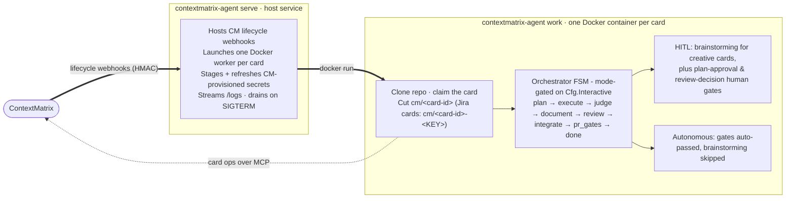

# ContextMatrix Agent

> [!WARNING]
>
> This project is under heavy development. Breaking changes should be expected
> at the current stage.

A custom Go agent harness with a configurable LLM endpoint that runs as a ContextMatrix
**task backend**: ContextMatrix dispatches a card, this service launches a Docker
worker container, and the worker drives a hand-built model-in-the-loop harness -
claiming the card, working the code in a target repository, and reporting
progress back to the board over MCP.

It is for operators who run [ContextMatrix](https://github.com/mhersson/contextmatrix)
and want model-flexible, cost-optimized autonomous execution: any
OpenAI-compatible model per role, picked by external quality priors per role
rather than a hard-coded vendor.

## How it fits ContextMatrix

ContextMatrix splits its backend contract into a `TaskBackend` (card lifecycle)
and a `ChatBackend` (interactive chat), resolved independently. This service
implements `TaskBackend`.

Two channels connect the agent to ContextMatrix:

- **Lifecycle webhooks (CM → agent).** ContextMatrix calls `/trigger`, `/kill`,
  `/stop-all`, `/message`, `/promote`, and `/end-session` over the
  [`contextmatrix-protocol`](https://github.com/mhersson/contextmatrix-protocol)
  HMAC contract. The agent reports status back to `/api/agent/*`.
- **Card operations (worker → CM, over MCP).** Inside each container the worker
  claims the card, heartbeats, reports usage, sets the orchestrator phase,
  transitions state, and completes the task using ContextMatrix MCP tools.

## Architecture

One binary, two runtime roles:



- **`serve`** is the task backend. It owns container lifecycle, resource limits,
  idle/timeout watchdogs, secret refresh, and graceful drain.
- **`work`** is the in-container agent. It runs the inner loop, fans out
  read-only review subagents, commits and pushes incrementally, and finalizes
  with an autosquash + force-push.

Two per-card execution strategies layer on top of the FSM, both switched on by
card fields set in ContextMatrix:

- **Best-of-N** (`best_of_n` ≥ 2) - after planning, the worker races N
  candidate implementations in parallel git worktrees, each with its own
  budget ledger and an auto-selected coder model (distinct models where the
  eligible pool allows, wrapping around when it is smaller than N); a judge
  phase picks the winner, which is adopted onto the main clone and pushed.
  Losing candidates never push and are removed.
- **Mob session** (`mob_participants` ≥ 2) - the plan and review phases
  convene a moderated multi-seat discussion over the A2A protocol (loopback
  JSON-RPC seats plus optional registered guest agents); when the card's
  execute-checkpoints flag is set, the execute phase additionally convenes a
  per-subtask checkpoint discussion ending in a proceed/revise verdict,
  tier-gated via the checkpoint min-tier. The decision model synthesizes each
  group's answer into the phase's normal output, and the live transcript
  streams to the card's chat tab on the board. Discussions degrade to the solo
  path rather than failing the run, and mob session composes freely with a
  Best-of-N execute race.

A project flagged as a **proof of concept** in ContextMatrix (`poc` on the
trigger payload) runs its cards on a lighter bar: tests cover the main
behaviour, and unless the card has mob review, one generic reviewer replaces
the three specialists and non-blocking findings are reported rather than
fixed. The verify gates are unchanged. See
[`docs/orchestrator.md`](docs/orchestrator.md#poc-projects).

The inner loop lives in the standalone `github.com/mhersson/contextmatrix-harness`
module (`events`, `llm`, `tools`, `harness`, `redact`) - FSM-free and
dependency-free, shared with the
[contextmatrix-chat](https://github.com/mhersson/contextmatrix-chat) backend.
This service wraps it with the task FSM (`orchestrator`/`worker`) to execute
board cards.

## Requirements

- **Go 1.27+** to build.
- **Docker** on the host running `serve` (the worker runtime).
- An **LLM endpoint API key** with access to the models you route to.
- A reachable **ContextMatrix** instance (API + MCP) and its MCP API key.
- **GitHub auth configured in ContextMatrix** (a GitHub App or a fine-grained
  PAT) - ContextMatrix mints per-run tokens for cloning and pushing target
  repositories; the agent itself carries no GitHub credentials.

## Quick start: the harness, standalone

Build the binary and drive the loop against a local workspace, no ContextMatrix
required. This is the fastest way to watch the inner loop work and to size a
weak model's tool-call reliability.

```bash
make build
export LLM_API_KEY=<your-api-key>
# For non-OpenRouter endpoints, also set:
#   export LLM_TYPE=openai
#   export LLM_BASE_URL=https://your-llm-endpoint.example/v1

# Run the harness on a workspace with a free-form task.
./contextmatrix-agent run \
  --model openai/gpt-oss-120b \
  --workspace /path/to/a/git/checkout \
  --task "Fix the failing TestAdd in calc_test.go, then run the tests." \
  --verify "go test ./..." \
  --transcript run.jsonl
```

## Running as a ContextMatrix backend

1. **Build the worker image.** The worker image bundles the agent binary plus
   the CLIs the harness expects; toolchain versions are pinned and
   SHA256-verified.

   ```bash
   make docker-worker          # tags contextmatrix-agent-worker:dev (full), labelled with the commit
   ```

   The image ships in five variants, selectable per project via the board's
   `remote_execution.worker_image`:

   | Variant    | Toolchains                                                            |
   | ---------- | --------------------------------------------------------------------- |
   | `full`     | Go, Node, Python, Rust toolchains - the default (`:dev` / `:latest`). |
   | `go-node`  | Go (+ golangci-lint, gofumpt) + Node.                                 |
   | `python`   | Node + uv/uvx + CPython + ty + ruff.                                  |
   | `rust`     | rustup/cargo (+ clippy, rustfmt). No Node.                            |
   | `jvm-node` | OpenJDK 21 + Maven + Node 24 + yarn (defers to a repo's Yarn Berry).  |

   Every variant also carries the baseline CLIs (`git`, `gh`, `rg`, `fd`,
   `shellcheck`, `shfmt`, `kubectl`, `kustomize`, `yq`, `task`, `zip`,
   `unzip`). Build the slim variants with `make docker-worker-variants` (tags
   `contextmatrix-agent-worker:go-node`, `:python`, `:rust`, `:jvm-node`).

   **Any other ecosystem ⇒ set the project's `remote_execution.worker_image` to
   a custom image** - see `docs/custom-images.md`.

   For deployment, publish a digest-pinned image (for example
   `ghcr.io/mhersson/contextmatrix-agent@sha256:...`) and reference it from
   `base_image`.

2. **Write the service config.** Copy the template and edit it. Every scalar
   field also has a `CMX_*` environment override (e.g. `CMX_BASE_IMAGE`);
   list/map fields are YAML-only or use the nested `CMX_…__KEY` form - see each
   field's note in the template.

   ```bash
   mkdir -p ~/.config/contextmatrix-agent
   cp serve.yaml.example ~/.config/contextmatrix-agent/serve.yaml
   # set: api_key, mcp_api_key, base_image, container_contextmatrix_url
   ```

   ContextMatrix provisions the git token and the LLM endpoint per run over
   the trigger payload - the agent carries no local credential config, and a
   trigger without CM-provisioned credentials is rejected.

   The real LLM key stays in `serve`: each worker gets a per-run stand-in token
   and calls `serve`'s LLM proxy at `container_serve_url` (default
   `http://host.docker.internal:<port>`), so a host firewall must allow
   container-to-host traffic on that port. Upstream LLM calls leave from
   `serve`, so they use `serve`'s own `HTTP(S)_PROXY`/`NO_PROXY` environment;
   an egress proxy set only in `worker_extra_env` does not reach them. See
   [`docs/secrets.md`](docs/secrets.md#llm-proxy).

   `container_contextmatrix_url` is required in practice - workers resolve their
   MCP URL from it; without it they point at their own localhost and fail to
   connect. For Docker bridge networking it is typically the bridge gateway
   (`http://172.17.0.1:8080`).

3. **Run the service.**

   ```bash
   ./contextmatrix-agent serve            # listens on :9092
   ```

   `serve` reads `--config` (default `~/.config/contextmatrix-agent/serve.yaml`)
   and validates it on startup. To check a config file use `config validate`, and
   `config defaults` prints every serve key with its default.

4. **Point ContextMatrix at it.** Enable the `backends.agent` entry in
   ContextMatrix's config (URL + shared `api_key` + `enabled: true`); the
   callback paths (`/api/agent/*`) are fixed by the protocol, not configured.
   A backend switch needs a ContextMatrix restart: drain running jobs → switch
   → restart.

### Service management

For an unattended deployment, run the agent as a systemd **user** service
instead of the foreground `serve` command:

```bash
make build                    # build the contextmatrix-agent binary
./svc.sh install              # write + enable ~/.config/systemd/user/contextmatrix-agent.service
./svc.sh start                # start it (also: stop / status / print / verify / uninstall)
```

The generated unit is sandboxed (read-only home, restricted syscalls, resource
caps) and runs `serve --config ${XDG_CONFIG_HOME:-~/.config}/contextmatrix-agent/serve.yaml`.

`redeploy.sh` updates a running install in place - rebuild the binary and all
worker images (full + variants), pin the new full-image digest into
`serve.yaml`, and restart the service:

```bash
./redeploy.sh
```

A stop or restart drains rather than drops running cards: on SIGTERM `serve`
refuses new work, sends every running worker an end-session so it pushes its
work in progress and releases its card, waits up to 30 seconds for the workers
to exit, then kills the rest. The kill sweep handles every card at once under
one 15-second deadline: it kills each worker still running (about 3 seconds of
kill grace) and reports each card failed unless the card's own exit reports
it, so a parked card keeps its completed status. The webhook listener
closes only after the sweep, because parking workers reach the LLM proxy on
it; the HTTP drain, shared with the admin listener, adds at most 10 seconds.
The sequence fits the unit's `TimeoutStopSec=60` however many cards are
running. A second signal skips the wait.

> **Run as UID 1000 on rootful Docker.** Per-run secrets are staged readable
> only by the UID `serve` runs as, and the worker container runs as UID 1000, so
> the service user must be host UID 1000 and Docker must not be rootless;
> otherwise every run fails to read its secrets. `serve` warns at startup on
> Linux when its UID is not 1000. Details in [`docs/secrets.md`](docs/secrets.md).

> **Writable runtime dir.** The agent writes secrets under `secrets_dir`
> (default `/var/run/cm-agent/secrets`). `/var/run` is root-owned and not created
> for a user service - either pre-create `/var/run/cm-agent` and `chown` it to
> your user, or set `secrets_dir` to a path under your home (e.g.
> `~/.cm-agent/secrets`); the unit whitelists both.

### Health and build info

`GET /health` is unauthenticated and returns `ok`, `running_containers`,
`max_concurrent`, `build` and `worker_image_revision`:

- `build` holds `version` (the exact tag the binary was built on, else
  omitted), `commit` (the full sha), `build_time` (RFC 3339, UTC) and
  `changes`: up to 20 merged PRs, newest first, leaving out Dependabot PRs and
  the `ci`, `docs`, `chore`, `build`, `test`, `refactor` and `style` types.
  `make build` and `make install` stamp these. A bare `go build` reports no
  commit and embeds whatever `internal/buildinfo/history/merges.log` the tree
  holds, so in a fresh clone it reports `changes: []`.
- `worker_image_revision` is `base_image`'s `org.opencontainers.image.revision`
  label, which `make docker-worker` and `make docker-worker-variants` stamp. It
  is omitted when the image is not local, has no label, or Docker does not
  answer within half a second. A per-project `worker_image` is not inspected.

## Commands

| Command                                    | Purpose                                                                            |
| ------------------------------------------ | ---------------------------------------------------------------------------------- |
| `serve`                                    | Run the task backend: host CM lifecycle webhooks, launch worker containers.        |
| `work`                                     | Container entrypoint (hidden): execute one card under CM control.                  |
| `run`                                      | Run the harness on a workspace with a free-form task (standalone).                 |
| `contextmatrix-agent config defaults`      | Print the complete default service config as YAML (schema for contextmatrix-setup) |
| `contextmatrix-agent config validate FILE` | Load `FILE` as `serve` would; exit 1 on the first error                            |

## Model selection

The agent never asks a model to name a model. During planning, a fixed capable
model emits a **complexity tier per subtask** (plus an overall card tier) -
simple / moderate / complex / critical; deterministic code then maps each tier
to the cost-optimal model. A
candidate must be tool-capable, not blacklisted, fit the work's context window,
and carry an external quality **prior** for the role that clears the tier's bar
(the bar rises with the tier, from 0.65 for simple up to 0.90 for critical).
Among those, an eligible operator favorite wins outright; otherwise the selector
picks the most capable candidate whose blended price is within a headroom band of
the cheapest (the band width is set on the ContextMatrix Model selection admin
page and arrives with each run; built-in 1.5x). Selection is **priors-only -
there is no measured-capability gate.** An explicit model pin on the card always
overrides.

When no candidate survives - nothing clears the tier bar, the candidate pool is
empty, or no `SelectionContext` catalog arrives - the selector returns the
**capable default**. That default resolves with precedence: the trigger's
`default_model` first, then the service's `default_model`
(`CMX_DEFAULT_MODEL`), then the compiled-in `deepseek/deepseek-v4-flash`.

The card's `max_capability` flag flips the selector to choose the most capable
candidate in the tier regardless of price: it ignores the headroom band, bypasses
operator favorites, and keeps the tier bar, blacklist, in-run exclusion, vendor
diversity, and window fit intact. Equal quality still tie-breaks to the cheaper
model. Use it for cards where the outcome matters more than cost.

The selector's inputs are supplied by ContextMatrix, not embedded in the binary.
Each trigger payload carries a `SelectionContext` with the candidate set, their
per-role priors, the operator favorites, a self-learning blacklist, the per-role
tier ladders and the price headroom; `registry.FromSelection` consumes it at run
start. The Artificial-Analysis sourcing, normalization, the ladders and the
headroom (edited on CM's admin page, Model selection) all live on the
ContextMatrix side.

The blacklist is self-learning: when a model proves harness-incapable mid-run
(for example, it cannot reliably call tools), the agent reports it back so it is
excluded and a replacement is re-selected.

Full policy detail - tier bars, vendor diversity, fallback precedence - lives
in [`docs/model-selection.md`](docs/model-selection.md).

## Development

```bash
make build          # go build ./... + the binary
make test           # go test ./...
make test-docker    # Docker integration suite (see below)
make lint           # golangci-lint run
make fmt            # gofumpt -w .
make docker-worker           # build the default (full) worker image
make docker-worker-variants  # build the go-node / python / rust / jvm-node variants
```

`make test-docker` needs a local Docker daemon and force-removes every
agent-labelled container on it, so never run it against a daemon a live
`serve` uses.

CI gates every pull request on `go test`, `go test -race`, `golangci-lint`, and
`go build`, plus `govulncheck`, `hadolint` on the worker Dockerfile and a
worker-image scan.

Conventions, package boundaries, the git workflow, and commit discipline for
working **on** this codebase live in [`AGENTS.md`](AGENTS.md).

## Further reading

- [`AGENTS.md`](AGENTS.md) - orientation for contributors and agents.
- [`docs/orchestrator.md`](docs/orchestrator.md) - how a card run works: phases,
  git workflow, review, verify resolution, plan split, repo grounding.
- [`docs/pr-gates.md`](docs/pr-gates.md) - the CI and Copilot gates.
- [`docs/model-selection.md`](docs/model-selection.md) - the selection policy.
- [`docs/secrets.md`](docs/secrets.md) - credential staging, the LLM proxy, and redaction.
- [`docs/observability.md`](docs/observability.md) - metrics and the admin listener.
- [`docs/custom-images.md`](docs/custom-images.md) - custom worker images.
- [`serve.yaml.example`](serve.yaml.example) - every service config field, documented.
- [ContextMatrix](https://github.com/mhersson/contextmatrix) - the control plane.

## License

MIT - see [`LICENSE`](LICENSE).
